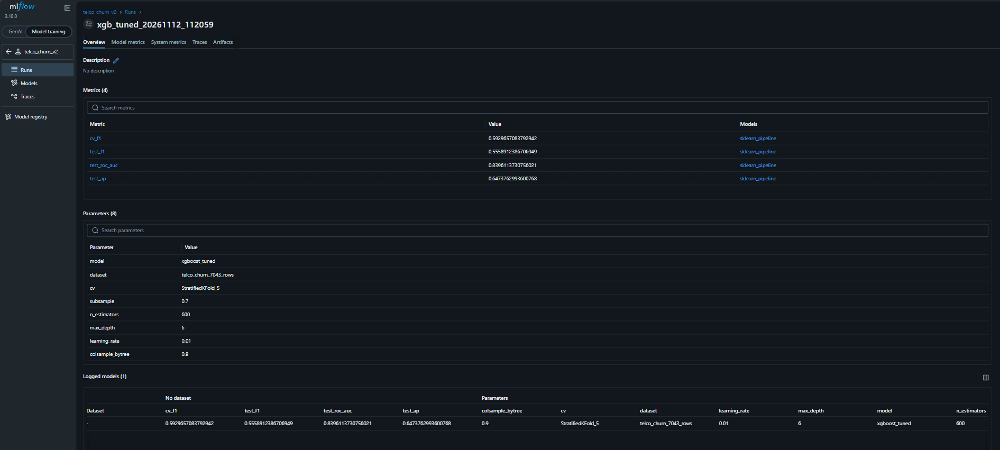
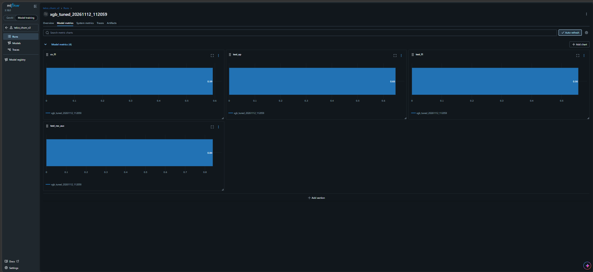
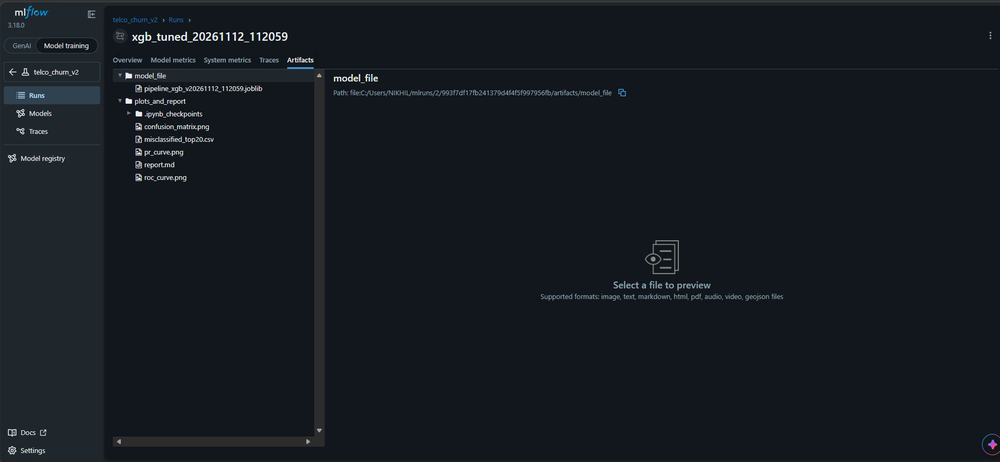

# Telco Customer Churn: Baseline ML Pipeline, Error Analysis & Experiment Tracking

Project: Artificial Intelligence (Interns), Model Training & Evaluation (Tasks 1, 2 and 3), Ayava internship.

## Overview
This repository contains an end-to-end, reproducible machine learning pipeline that predicts which customers are likely to churn, an error analysis that explains where and why the model fails, and MLflow experiment tracking for every run. The use case is customer retention for a subscription-based product, built to show proper pipeline design and proper evaluation instead of relying on a single accuracy number.

## Dataset
IBM Telco Customer Churn: 7,043 customers, 20 features (contract, tenure, services, billing), target `Churn` (about 27% positive).

## Task 1: Baseline pipeline
- Preprocessing inside a scikit-learn Pipeline (median/mode imputation, scaling, one-hot encoding), so no information leaks from the test data.
- Stratified 80/20 train-test split and 5-fold stratified cross-validation.
- Baselines: random guess, Logistic Regression, Random Forest. Tuned model: XGBoost (RandomizedSearchCV).
- Final pipeline saved with joblib plus JSON metadata, versioned by timestamp.

| Model | CV F1 |
|---|---|
| Random guess | 0.269 |
| Logistic Regression | 0.629 |
| Random Forest | 0.544 |
| XGBoost (tuned) | 0.593 |

Logistic Regression scores higher in CV F1 because it uses class weights; the tuned XGBoost was trained without them.

## Task 2: Evaluation and error analysis
Test set (XGBoost): F1 0.556, ROC-AUC 0.84, Average Precision 0.647. 294 of 1,405 test customers were misclassified (188 missed churn, 106 false alarms). I reviewed the 20 most confident errors and found two failure modes:
1. Confident misses on customers who look loyal (long contract, long tenure, no internet service). The data has no signal for why they left.
2. Month-to-month and short-tenure customers are hard to separate. 86% of all errors are month-to-month customers.

Proposed data-level fixes: behavioural features (support calls, usage trend, renewal date), engineered features (tenure buckets, charges per tenure month), more data for new customers, class weights or SMOTE inside cross-validation, and a tuned decision threshold.

## Task 3: Experiment tracking (MLflow)
Experiment `telco_churn_v2` has 4 runs: random guess, logistic regression, random forest and tuned XGBoost. Each run logs parameters (model, CV setup, best XGBoost hyperparameters), metrics (CV F1, test F1, ROC-AUC, AP) and artifacts (plots, report, misclassified samples, saved joblib pipeline, sklearn model). Run `mlflow ui --backend-store-uri sqlite:///mlflow.db` to browse them.

## Files
- `Ayava.ipynb`: full notebook (Tasks 1, 2 and 3)
- `outputs_bundle/`: confusion matrix, PR and ROC curves, misclassified samples, `report.md`
- `models_bundle/`: saved pipeline (.joblib) and metadata (.json)
- `mlflow_screenshots/`: MLflow UI screenshots
